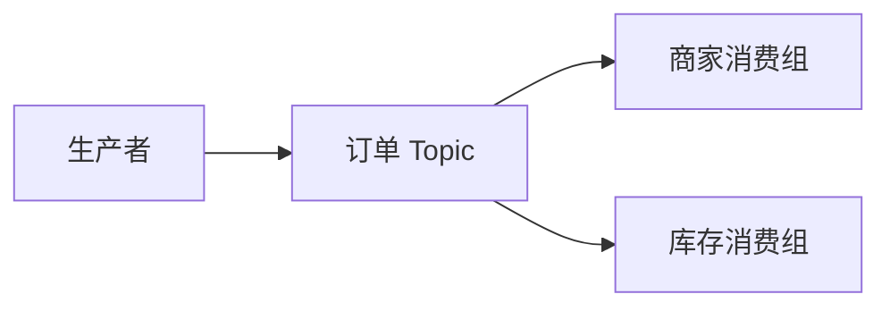

# 博客编辑规范

## 内容注释（Annotation）

为专业术语、缩写等补充解释时，使用 VuePress Plume 的内容注释语法。说明内容默认隐藏，读者点击正文中的注释标签后显示。

### 基本写法

- 在正文术语后添加 `[+label]`，标签左侧必须留一个空格，例如 `CDC [+CDC]`。
- 在文档的单独区域使用 `[+label]:` 定义说明，标签名称必须与正文引用一致，不能省略 `+`。
- 简短内容可以直接写在冒号后；多行内容可以从下一行开始，每行统一缩进两个空格。段落之间可以留空行，后续内容仍须保持缩进；不再缩进即表示定义结束。
- 注释内容支持 Markdown。解释缩写时，优先包含英文全称、中文名称和结合当前场景的简短说明。
- 同一个标签允许有多个定义，点击后会以列表展示。仅在确实需要多条说明时使用，避免意外重复定义。
- 不要将需要点击展开的术语解释写成普通正文或脚注 `[^label]`。

单行示例：

```md
通过 CDC [+CDC] 同步订单变化。

[+CDC]: CDC（Change Data Capture，变更数据捕获）用于捕获数据库中的数据变化，并传递给下游系统。
```

多行示例：

```md
通过 CDC [+CDC] 同步订单变化。

[+CDC]:
  CDC（Change Data Capture，变更数据捕获）用于捕获数据库中的新增、修改和删除，并传递给下游系统。

  在订单场景中，可以订阅 MySQL 的 binlog，将订单主表已提交的变更同步到商家查询表。
```

### 功能配置与全局预设

该功能需要在主题配置中启用。修改配置前先检查仓库现有设置，避免重复配置。以下为 `.vuepress/config.ts` 中的配置示例：

```ts
export default defineUserConfig({
  theme: plumeTheme({
    markdown: {
      annotation: true,
    },
  }),
})
```

跨文档复用的常用注释可以在 `markdown.annotation` 中以对象形式预设，或使用 `markdown.env.annotations`。预设值可以是字符串，也可以是字符串数组（展示为多条说明）。已配置全局预设的标签可在任意 Markdown 文件中直接引用，无需重复定义。

```ts
markdown: {
  annotation: {
    CDC: 'CDC（Change Data Capture，变更数据捕获）用于捕获数据库中的数据变化，并传递给下游系统。',
  },
}
```

只在单篇文章中使用、或解释依赖具体上下文的注释，优先在文章内定义；不要为一次局部补充随意修改全局预设。

## 缩写词（Abbreviation）

为缩写补充英文全称、中文名称或简短解释时，可以使用缩写词语法。读者将鼠标移到正文中的缩写词上，即可查看说明；正文无需添加引用标签。较长、需要点击展开的场景说明仍使用上面的内容注释，两者可以配合使用。

### 基本写法

- 在单独一行使用 `*[缩写词]: 描述` 定义，描述支持 Markdown 内联语法。
- 正文中的普通文本会自动匹配已定义的缩写词，无需写成 `[+label]`，也不要为悬停解释将缩写词包在代码反引号中。
- 缩写词应是独立的单词或词组；中文缩写词左右应加空格，以区分词语边界。
- 优先使用“英文全称，中文名称；简短解释”的格式。同一篇文章中的同一缩写只定义一次，可统一放在文末。

```md
通过 CDC 同步订单变化。

*[CDC]: Change Data Capture，变更数据捕获；捕获数据库中的新增、修改和删除，并将变化传递给下游系统。
```

### 功能配置与全局预设

该功能默认不启用，需要在主题中设置 `markdown.abbr: true`。修改前先检查现有配置。

```ts
export default defineUserConfig({
  theme: plumeTheme({
    markdown: {
      abbr: true,
    },
  }),
})
```

常用缩写可以在 `markdown.abbr` 中以对象形式预设，也可以通过 `markdown.env.abbreviations` 配置。全局预设可在所有 Markdown 文件中使用，无需在每篇文章中重复定义；单篇文章专用的解释优先在文章内定义。

```ts
markdown: {
  abbr: {
    CDC: 'Change Data Capture，变更数据捕获',
  },
}
```

等效的全局预设位置：

```ts
markdown: {
  env: {
    abbreviations: {
      CDC: 'Change Data Capture，变更数据捕获',
    },
  },
}
```

## Mermaid 图表

允许并鼓励在关系、流程或交互难以仅靠文字解释时使用 Mermaid，例如架构关系图、消息流转图、时序图。简单事实无需强行配图。

- 优先使用标准 `mermaid` 围栏代码块，并在第一行声明图类型，例如 `flowchart LR`、`sequenceDiagram`、`classDiagram`、`erDiagram`、`stateDiagram-v2`。
- 主题也支持图类型别名代码块，例如 `sequence`、`class`、`er`、`state`、`gantt`、`mindmap`；别名会自动声明类型，不要再重复声明。使用前确认当前插件版本支持，尤其是 beta 图类型。
- 流程与模型关系优先使用流程图；调用顺序、事务和异步交互优先使用时序图。图中的箭头需明确表达包含、部署、订阅或消息传递关系，不要混淆不同维度。
- 节点使用简短 ID 和清晰标签，含标点或复杂文本时将标签放入双引号。保持图规模适中，必要时拆图，并在图前后解释关键假设与边界。
- 图表直接写在文章中，无需生成图片。检查代码块闭合、节点引用及语法；有可用的 Mermaid 渲染环境时验证渲染。
- 启用或修改 Markdown 插件后，如果页面仍显示旧代码块，注意主题的文件缓存可能保留旧编译结果。使用 `pnpm docs:dev-clean` 清理缓存和临时文件后重启，再刷新页面验证；仅成功启动开发服务不代表图表已正确渲染。
- 该功能需要安装 `mermaid` 并启用主题的 `markdown.mermaid: true`。先检查现有依赖和配置，避免重复安装或覆盖配置。需要自定义时，可在客户端配置中使用 `@vuepress/plugin-markdown-chart/client` 的 `defineMermaidConfig`。

示例：

````md

````
