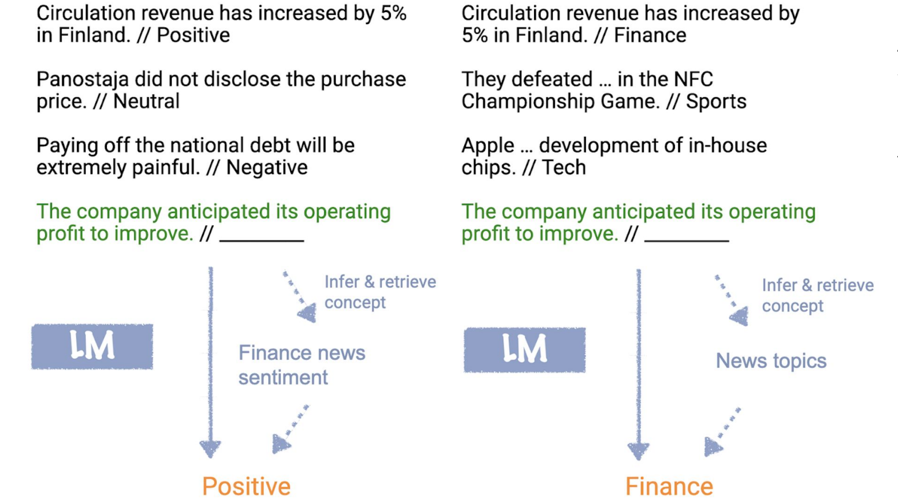
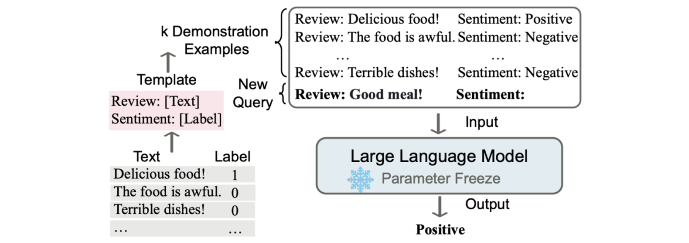
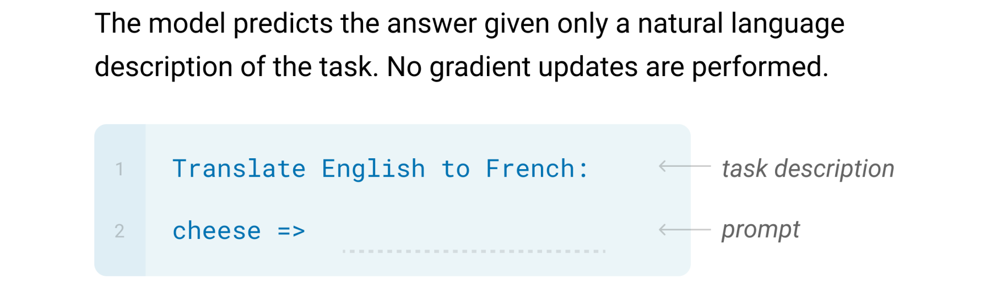
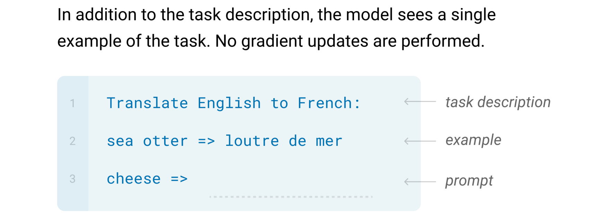
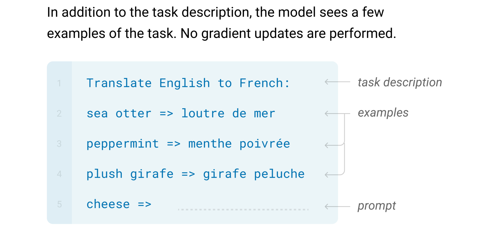
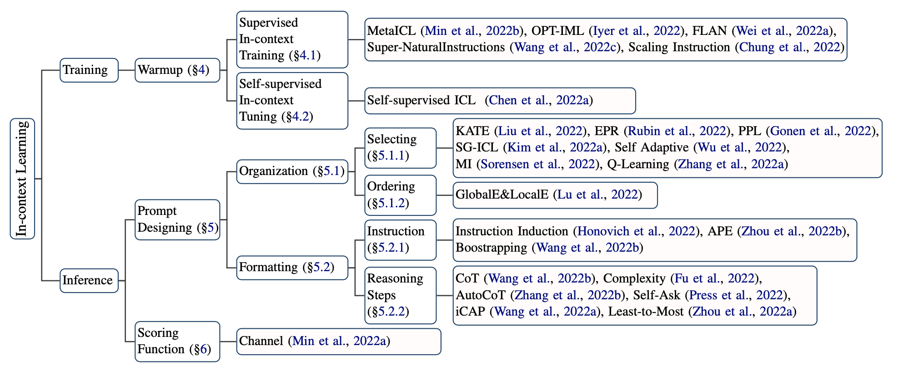

## 1. In-Context Learning 背景与定义

### 背景

大规模预训练语言模型（LLM）如 GPT-3 是在大规模的互联网文本数据上训练，以给定的前缀来预测生成下一个 token（Next token prediction）。通过预测词的训练目标、大规模数据集以及超高参数量的模型相结合，产生了性能极强的 LLM，它可以“理解”任何文本输入，并在其基础上进行“写作”。除此以外，GPT-3 的论文发现，大规模的训练数据会产生一种有趣的新兴行为，称为 In-Context Learning（又称上下文学习、语境学习，ICL）。它并不需要调整模型参数，仅用几条下游任务的示例就可以取得极佳的结果。

### 定义

In-Context Learning 最初是在原始 GPT-3 论文中作为一种大语言模型学习任务的方式而被推广的，能够直接让语言模型根据给定的几个实例理解任务，并给出问题答案；**本质上，它相当于使用训练完好的语言模型估计给定示例条件下的条件概率分布模型**。

在 In-Context Learning 里，给语言模型一个“提示（prompt）”，该提示是一个由输入输出对组成的列表，这些输入输出对用来描述一个任务。在提示的末尾，有一个测试输入，并让语言模型仅通过以提示为条件来预测下一个标记。为了正确回答以下两个提示，模型需要理解 In-Context Learning 的演示示例，以确定输入分布（财经或一般新闻）、输出分布（积极/消极或主题）、输入-输出映射（情感或主题分类）以及格式。

### 与其他概念的区别

- **提示学习**：通过设计离散模板或者连续型参数，学习合适的 prompt 引导模型输出期望的结果，而 prompt 既可以是离散型，也可以是连续型。严格来讲，如果将 in-context learning 中的若干示例的演示视作精选的 prompt 的话，可以视为提示学习中的一小部分。
- **小样本学习**：小样本学习为了学习到最佳模型参数，仍然需要使用少量的监督样本做微调，而 ICL 则不对模型做任何的微调，直接将下游任务的输入输出拼接起来作为一个 prompt，引导模型根据输入的测试集样本 demo，给出任务的预测结果。

In-context learning **允许用户为新用例快速构建模型，而无需为每个任务微调和存储新参数**。它通常只需要很少的训练示例就可以使模型正常工作，而且即使对于非专家来说，也可以通过直观的自然语言来进行交互。这改变了之前需要把大模型用到下游任务的范式。对于一些 LLM 没有见过的新任务，只需要设计一些任务的语言描述，并给出几个任务实例，作为模型的输入，即可让模型从给定的情景中学习新任务并给出满意的回答结果。这种训练方式能够有效提升模型小样本学习的能力。

ICL 的关键思想是从**任务相关的类比样本中学习**。下图给出了一个描述语言模型如何使用 ICL 进行决策的例子。

- 首先，ICL 需要一些示例来形成一个演示上下文。这些示例通常是用自然语言模板编写的。
- 然后 ICL 将查询的问题（即你需要预测标签的输入）和一个上下文演示（一些相关的示例）连接在一起，形成带有提示的输入。与监督学习需要使用反向梯度更新模型参数的训练阶段不同，ICL 不进行参数更新，而是直接在预训练的语言模型上进行预测。模型预计将从演示中学习到的模式进行正确的预测。
- 本质上，它利用训练有素的语言模型根据演示的示例来估计候选答案的可能性。简单理解，就是通过若干个完整的示例，让语言模型更好地理解当前的任务，从而做出更加准确的预测。

值得注意的是，与需要使用反向梯度更新模型参数的训练阶段的监督学习不同，ICL 不需要参数更新，并直接对预先训练好的语言模型进行预测（**这是与 prompt、传统 demonstration learning 不同的地方，ICL 不需要在下游 P-tuning 或 Fine-tuning**）。该模型学习隐藏在演示中的模式，并据此做出正确的预测。使用下游任务的演示信息学习并推理，通常是“实例-标签”形式（Fine tuning 与 Prompt Learning 仍需在大量训练数据中学习类别表示等）。

1. **Zero-shot learning**：不允许输入任何示例，只允许输入一则任务说明。

   

2. **One-shot learning**：只允许输入一条示例和一则任务说明。

   

3. **Few-shot learning**：区别于小样本学习概念，无需更新参数，允许输入数条示例和一则任务说明。

   

## 2. ICL 两个阶段的优化方法

ICL 分精调和推断两个优化方法阶段：

- **精调阶段**：目前优化的方法基本都是基于 pretrained LLM，然后选择性地预热模型来增强和泛化 ICL 的能力。
- **推理阶段**：优化方法主要分为 Prompt 设计和打分函数（Scoring Function）设计两种。

精调和推理阶段是 ICL 的两个主要阶段。在精调阶段，现有的 ICL 研究主要以预训练的 LLM 为主，并可选地预热模型以增强和泛化 ICL 能力。在推理阶段，演示设计和评分函数的选择对于最终性能至关重要。

### 2.1 通过精调优化 ICL 效果

在推理前，通过持续学习让语言模型的 ICL 能力得到进一步提升，这个过程称之为 warmup。warmup 会优化语言模型对应参数或者新增参数，区别于传统的 finetune：finetune 旨在提升 LLM 在特定任务上的表现，而 warmup 则是提升模型整体的 ICL 性能。

虽然预训练后的语言模型已经初步具备 ICL 能力，但预训练的 MLM 目标和下游 ICL 目标还是存在差距的，怎样精调才能把模型预热（warmup）、提升 ICL 效果是一个重要的研究方向。

> 注：这里的“精调”“预热”不是为了让模型适配某个下游任务，而是让模型具备更好的通用 ICL 能力。

**有监督 ICL 训练**

第一类方法非常直觉：既然要消除差距，可以直接在有监督的 ICL 数据上训练，通过构建对应的 in-context 监督数据与多任务训练，进行对应的 in-context finetune，从而缩小预训练与下游 ICL 的差距。MetaICL 就直接把很多任务整合成了 ICL 的形式精调模型，在 52 个数据集上取得了比肩直接精调的效果。

另外还有部分研究专注于 Instruction tuning，构建更好的任务描述让模型去理解，而不是只给几个例子（demonstration），比如 LaMDA-PT、FLAN。

**自监督 ICL 训练**

有监督的数据毕竟是有限的，于是开始有研究者思考能不能借鉴预训练的方式，自监督地进行 ICL 训练。根据 ICL 的格式将原始数据转换成 input-output 的 pair 对数据后，利用四个自监督目标进行训练，包括掩码语言、分类任务等。

有监督 ICL 训练和自监督 ICL 训练旨在**通过引入更加接近于 in-context learning 的训练目标，从而缩小预训练与 ICL 之间的差距**。比起需要示例的 in-context fine tuning，只涉及任务描述的 instruct finetuning 更加简单且受欢迎。另外，在 warmup 这个阶段，语言模型只需要从少量数据训练就能明显提升 ICL 能力，不断增加相关数据并不能带来 ICL 能力的持续提升。从某种角度上看，这些方法通过调整模型参数可以提升 ICL 能力，也表明了原始的 LLM 具备这种潜力。虽然 ICL 不要求 warmup，但是一般推荐在推理前增加一个 warmup 过程。

### 2.2 在推理阶段优化 ICL 效果

推理阶段的优化方法分为 Prompt 设计和打分函数（Scoring Function）设计两种。

#### Prompt 设计

作为激发大模型能力的输入，Prompt 对 ICL 的效果影响很大。可以从组织方式和格式来进行 Prompt 的设计。组织方式是指如何选择数据样本并排序，格式是指怎么去写 Prompt。

**数据样本选取**

对于数据样本的选取，可以有以下方法：

- **无监督**：首先就是根据句向量距离或者互信息等方式，选择跟当前输入 x 最相似的样本作为演示例；另外还有利用自使用方法去选择最佳的示例排列；有的方法还会考虑到演示示例的泛化能力，尽可能去提高示例的多样性。除了上述这些从人工撰写的样本中选择示例的方式外，还可以利用语言模型自身去生成合适的演示示例。
- **有监督**：第一种是先利用无监督检索器召回若干相似的样本，再通过监督学习训练的 Efficient Prompt Retriever 进行打分，从而筛选出最合适的样本。此外还有把样本选择建模成序列决策任务，把最终效果当作 reward，用强化学习的方式去选择样本。

**数据样本排序**

对于数据样本的排序，目前的研究并不多，有两个思路：

- 基于一些距离度量，把跟输入相近的排在后面（靠近输入）。
- 在 Lu 等人的研究中，他们找到了信息熵和 ICL 效果的联系，因此根据熵来决定最佳排序。

**Prompt 格式**

对于 Prompt 的格式，常见有两种：指令（Instruction）和推理步骤（Reasoning Steps）说明。

- **Instruction**：任务的指令描述非常依赖人工，不过也可以尝试让语言模型自动生成描述并选择。
- **Reasoning Steps**：对于更复杂的任务，可以人工显式地把推理步骤写出来，比如 Chain-of-thought（CoT），来启发模型的推理能力。除了纯人工撰写外，还有以下方法：
  - 让模型自己生成推理步骤。
  - **Multi-stage ICL**：分多个步骤来完成任务，每一步都设计不同的子问题，让模型一步步解答。比如 Self-Ask 这篇工作甚至让模型自己问自己；再比如 Least-to-Most Prompting 这篇工作先让模型把大问题拆成多个子问题，再挨个回答。

#### 打分函数（Scoring Function）

评分函数决定我们如何将语言模型的预测转换为对特定答案可能性的估计。

- **直接估计方法（Direct）**：直接取候选答案的条件概率，可以用语言模型词汇表中的符号表示（Brown et al., 2020）。选择概率较高的答案作为最终答案。但是，这种方法的缺点是只能衡量固定模式的答案（答案标记应该放在输入序列的末尾）。
- **困惑度（Perplexity, PPL）**：计算由演示示例 C、输入查询 x 和候选标签 y 的标记组成的整个输入序列 S = {C, s(x, y, I)} 的句子 Perplexity。由于 PPL 计算整个句子的概率，它消除了标记位置的限制，但需要额外的计算时间。再用语言模型过一遍句子，这种方法可以解决上述固定模式的问题，但计算量增加了。
- **通道模型（Channel）**：评估 P(x|y) 的条件概率（贝叶斯推理），即在给定标签的情况下估计输入查询的可能性。通过这种方式，语言模型需要生成输入中的每个令牌，这可以在不平衡的训练数据状态下提高性能。

## 3. 应用

上下文学习在许多 NLP 的 benchmark 测试中，已经媲美甚至超过全资源微调的方法，例如在 LAMBADA（常识句子补全）和 TriviaQA（问答）上达到 SOTA。更令人意外的是，上下文学习使人们能够在短短几个小时内启动一系列应用程序，包括根据自然语言描述编写代码、帮助设计应用程序模型以及概括电子表格功能。

## 4. ICL 的优缺点

### 4.1 优点

- 输入的形式是自然语言，这提供了一个跟 LLM 交流的可解释性手段，可以让我们更好地跟语言模型交互。通过修改模板和示例说明我们想要什么，甚至可以把一些知识直接输入给模型，通过这些示例跟模板让语言模型更容易利用到人类的知识。
- 这种学习方式类似于人类类比学习的决策过程，即通过几个例子去类比，而不是像精调一样从大量语料中统计出规律。
- 相比于监督学习，ICL 是一种免训练的学习框架。不仅减少了计算模型适配新任务的计算成本，而且可以使语言模型即服务（Language-Model-as-a-Service, LMaaS）这种模式成为可能，更容易应用到更多真实场景的任务。

### 4.2 缺点

- 模型对不同的 contexts 较为敏感。很小的变化甚至会导致很大的方差。
- 缺乏对 in-context learning 的理论和实验分析。In-context learning 到底学到的是什么，又是怎么学到的。
- 应用受限。context size 的上限为 2048 个字符。由于 content limit，一些任务更适合用 fine-tuning 来做。这也导致一些研究结论其实并未在文本生成类的任务上进行验证。
- few-shot setting 下的性能饱和问题，即随着 training examples 的数量的增加（一般是 16 或者 32 左右），in-context learning 的性能不再提升。

## 5. ICL 底层机制

### 5.1 预训练怎样影响 ICL

ICL 是在 GPT-3 中首次提出的，它表明随着模型尺寸的增大，ICL 的能力变得更加明显。

然而，一些研究表明，小规模的 PLM 也可以通过专门设计的训练任务（例如，学习以任务示例和查询作为输入来预测标签）表现出强大的 ICL 能力，甚至可能超过更大的模型。这表明训练任务的设计是影响 LLM ICL 能力的一个重要因素。

除了训练任务外，最近的研究还调查了 ICL 和预训练语料库之间的关系。研究表明，ICL 的性能在很大程度上取决于预训练语料库的来源，而不是规模。

另一项研究对训练数据分布的影响进行了深入分析。他们发现，当训练数据可以聚类到许多不常见的类中，而不是均匀分布时，ICL 就会出现。

### 5.2 LLMs 怎样执行 ICL

在推理阶段，研究人员专注于基于给定的演示来分析 ICL 能力是如何运行的，因为不涉及显式学习或更新。他们通常从梯度下降的角度进行分析，并将 ICL 视为隐式微调。

在这个框架下，ICL 过程可以解释如下：通过前向计算，LLM 生成关于演示的元梯度，并通过注意力机制隐式地执行梯度下降。实验也表明，LLM 中的某些注意力头能够执行与任务无关的原子操作（例如，复制和前缀匹配），这与 ICL 能力密切相关。

为了进一步探索 ICL 的工作机制，一些研究将 ICL 抽象为一个算法学习过程。具体而言，LLM 在预训练期间基本上通过其参数对隐式模型进行编码。通过 ICL 中提供的例子，LLM 可以实现诸如梯度下降之类的学习算法，或者直接计算闭式解，以在前向计算期间更新这些模型。在这个解释框架下，已经表明 LLM 可以有效地学习简单的线性函数，甚至可以使用 ICL 学习一些复杂的函数，如决策树。

### 5.3 为什么有效

- **训练数据分布**：模型在大量的语料预训练过程中，学习到大量的“concept”。“concept”可以看作是一个潜在的变量，变量包含多种多样文本级别的数据。“concept”结合非常多的潜在变量指定了一个文本语义的方方面面。
- **学习机制**：有学者猜测 LM 可能自己就具备学习的能力，在做 ICL 的时候学到了这些知识，或者隐式直接精调了自己。
- **Transformer 模块**：有学者发现 Transformer 里的某些注意力头会通过拷贝固定的模式来预测下一个 token。

## 6. 关键知识点

1. ICL 有效果的原因：训练数据的分布、学习机制、Transformer 模块。
2. ICL 的分类常见有哪几种：1. 只允许输入一条示例和一则任务说明；2. 允许输入数条示例和一则任务说明；3. 不允许输入任何示例，只允许输入一则任务说明。
3. In-Context Learning 只对大模型有效。
4. 在训练阶段，可以通过自监督的 In-Context Learning 训练优化模型效果，从而让模型具备更好的通用能力。
5. In-Context Learning 类似于人类的类比学习的决策过程，举一反三。
6. 推理阶段的优化方法分为微调（Fine tune）和打分函数（Scoring Function）设计。
7. 大语言模型在使用 ICL 进行决策时，不需要进行参数更新，然后进行预测。
